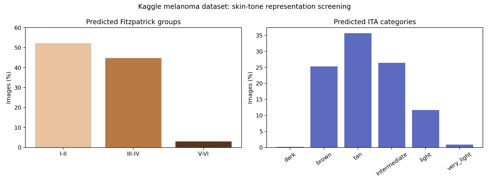

# Colorimetry audit

Tools built on top of [marinbenc/nn_colorimetry_dermatoscopy](https://github.com/marinbenc/nn_colorimetry_dermatoscopy), a published model that predicts Fitzpatrick type (EfficientNet-B4 with a CORAL ordinal head) and CIELab color, and therefore ITA, from dermatoscopic images. Each prediction comes from five cross-validation fold models.

These files are **additions** to that repo. Copy them into a clone of it, which provides `model_factory.py` and the released weights.

| File | What it does |
|---|---|
| [`run_images.py`](run_images.py) | Runs both released models on any images, folders or URLs. For each image it outputs the Fitzpatrick call, each fold's prediction, a per-fold **confidence** derived from the CORAL probabilities (plus a "within one type" confidence), and ITA. Can append to a CSV, skipping images already listed, and optionally add lesion-masked ITA from [`04-lesion-masked-ita`](../04-lesion-masked-ita). |
| [`colorimetry_sync.sh`](colorimetry_sync.sh) | Cloud workflow on a GCP Compute Engine VM. It syncs new images from a Cloud Storage `images/` folder, runs `run_images.py`, and appends one row per new image to `results/results.csv` in the bucket. |
| [`setup_cloudshell.sh`](setup_cloudshell.sh) | One-file setup for running the models in Google Cloud Shell, which has a 5 GB disk. |
| [`audit_kaggle_melanoma.py`](audit_kaggle_melanoma.py) | Full representation audit of a folder-structured dataset. It produces predicted Fitzpatrick and ITA distributions, ensemble-disagreement review flags, exact-duplicate detection across train/test, and a Markdown report. |
| [`audit_workimage.py`](audit_workimage.py), [`workimage_masking.py`](workimage_masking.py) | Audit of pre-masked image pairs. Pixel ITA is computed only on retained skin, and masked regions are filled with neutral skin color before neural inference. |
| [`tests/`](tests) | Tests for the masking logic. |
| [`audit_results/`](audit_results) | Reports from the 10,605-image Kaggle melanoma audit and a smoke test. |

**Kaggle melanoma audit:** 3.0% of images predicted Fitzpatrick V–VI, 28% flagged for review, and 14 exact duplicates spanning train and test. See the [full report](audit_results/kaggle_melanoma/REPORT.md).
