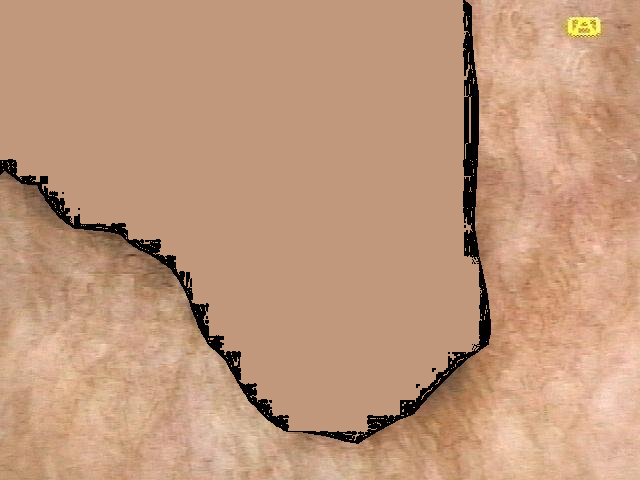
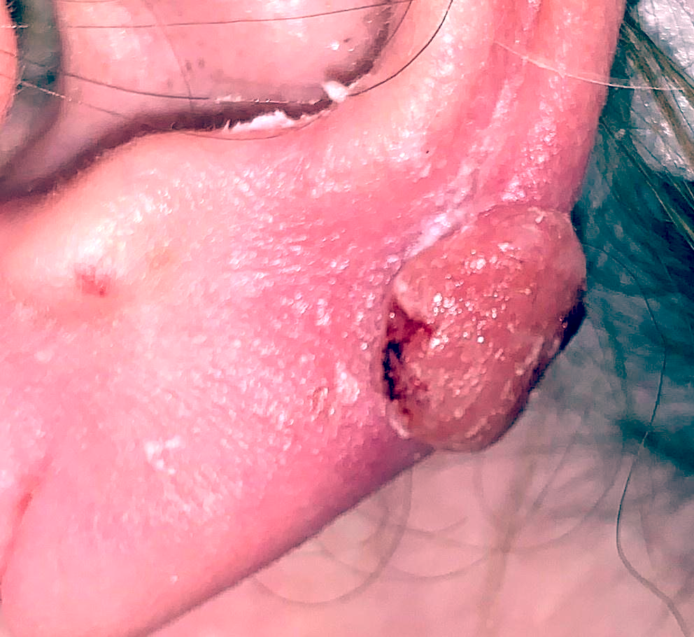

# Lesion-masked ITA

ITA (Individual Typology Angle) measures skin tone from CIELab color: `ITA = arctan((L* − 50) / b*)`. If lesion pixels are included, a dark mole or red rash drags the estimate away from the patient's actual skin tone. This module **masks the lesion first, then computes ITA on the remaining healthy skin**. It abstains when too little healthy skin is left (under 5% of the image).

```bash
pip install -r lesion_masked_ita/requirements.txt
python -m lesion_masked_ita photo.jpg --out overlay.png
python -m lesion_masked_ita images/ --backend kmeans --csv results.csv --overlay-dir overlays/
python -m lesion_masked_ita.check   # synthetic check: a dark lesion must not dominate masked ITA
```

| Backend | How it finds the lesion | Extra weights |
|---|---|---|
| `kmeans` | Lab color clustering | none |
| `unet` | ISIC 2018 U-Net (ResNet34) | downloaded from Hugging Face |
| `sam_adapter` | SAM ViT-B + Melanoma_Photo medical adapter | see [`medical_sam_adapter/PIN.txt`](medical_sam_adapter/PIN.txt) |

| File | What it does |
|---|---|
| [`lesion_masked_ita/core.py`](lesion_masked_ita/core.py) | Masking backends, ITA computation and review overlays |
| [`lesion_masked_ita/__main__.py`](lesion_masked_ita/__main__.py) | CLI with CSV output and overlay export |
| [`lesion_masked_ita/eval_isic.py`](lesion_masked_ita/eval_isic.py) | Compares backends on ISIC 2016 test masks: Dice score and ITA error versus ground-truth-masked ITA |
| [`lesion_masked_ita/sam_adapter.py`](lesion_masked_ita/sam_adapter.py) | SAM + adapter backend |
| [`lesion_masked_ita/check.py`](lesion_masked_ita/check.py) | Self-check on a synthetic image |
| [`lesion_masked_ita_sync.sh`](lesion_masked_ita_sync.sh) | Cloud Storage → VM → results-sheet workflow with masked ITA and overlays |

Example pipeline images (ISIC Archive):

| Lesion filled with surrounding skin color | 224×224 model input | Camera-color corrected |
|---|---|---|
|  |  |  |
