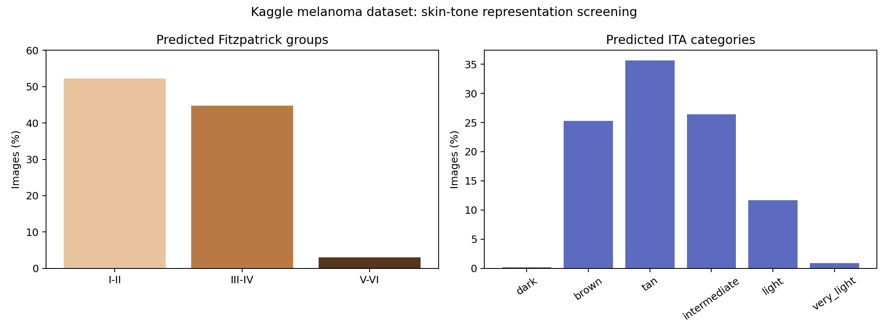
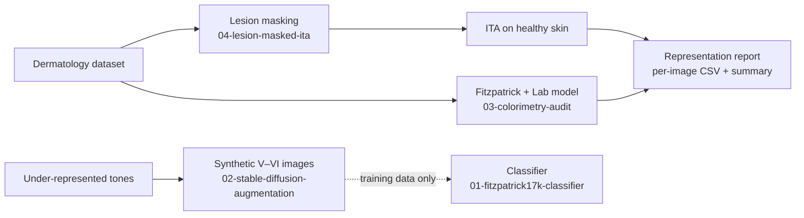
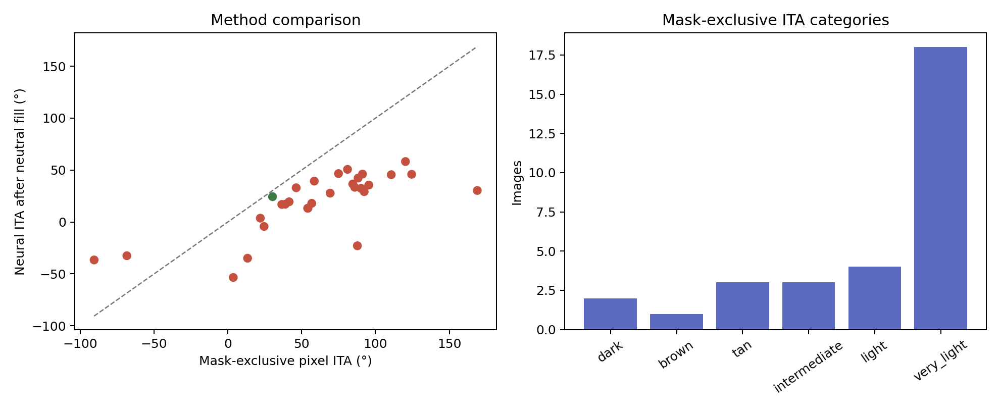

# Skin Tone Auditor

**Measuring skin-tone representation in dermatology image datasets.**

Dermatology AI models perform worse on darker skin, partly because the datasets they learn from are unlabeled for skin tone and heavily skewed toward lighter skin. This project builds the measurement side of that problem: an **auditor** that takes a dermatology dataset and reports how skin tones are represented in it, using continuous **ITA** (Individual Typology Angle) as the primary measure, with **Fitzpatrick type** kept for compatibility.

It is deliberately *not* a diagnostic tool. The goal is a validator dermatologists can check.

*Screening a public 10,605-image melanoma dataset: only 3% of images are predicted Fitzpatrick V–VI.*

---

## What's in this repo

| Folder | What it is | Stack |
|---|---|---|
| [`01-fitzpatrick17k-classifier`](01-fitzpatrick17k-classifier) | Lesion-robust light/dark skin-tone classifier and the Fitzpatrick17k data pipeline | PyTorch, timm (EfficientNet-B3, ConvNeXt), Albumentations, Grad-CAM, Vertex AI AutoML |
| [`02-stable-diffusion-augmentation`](02-stable-diffusion-augmentation) | Synthetic image generation to fill in under-represented darker skin tones (Fitzpatrick V–VI) | Stable Diffusion 1.5, ControlNet (SoftEdge/HED), Gemini 2.5 Flash vision, GCS |
| [`03-colorimetry-audit`](03-colorimetry-audit) | Dataset audits and a cloud pipeline built around a colorimeter-supervised Fitzpatrick + ITA model | PyTorch, CORAL ordinal regression, GCP Compute Engine + Cloud Storage |
| [`04-lesion-masked-ita`](04-lesion-masked-ita) | Masks out the lesion, then measures ITA on the remaining healthy skin only | OpenCV, scikit-image, U-Net, SAM + medical adapter |
| [`results`](results) | Reports and per-image outputs from runs on SCIN, DDI and ISIC images | CSV, Markdown reports |

## Highlights

- **Coarse skin-tone classification works; fine-grained does not.** On cleaned Fitzpatrick17k, a light / medium / dark model reached **PR AUC 0.946**, while six-class Fitzpatrick reached **0.774**, with performance tracking class size. The bottleneck is data (only 369 clean type VI images), not architecture.
- **Audited a public 10,605-image melanoma dataset** ([report](03-colorimetry-audit/audit_results/kaggle_melanoma/REPORT.md)): 3.0% predicted Fitzpatrick V–VI, 28% flagged for review, and 14 exact duplicate images leaking between train and test.
- **Checked a published colorimetry model on 200 SCIN clinical photos** ([report](results/scin-200-efst-check/scin-efst-colorimetry-report.txt)): within one Fitzpatrick type of the dermatologist label 88.5% of the time, but it systematically pushes lighter skin darker, and its ITA values aren't calibrated on clinical photos.
- **Showed lesions bias skin-tone estimates.** Excluding the lesion before measuring ITA changed the result by a median of 45° on ISIC dermoscopy images ([report](results/isic-mask-audit/REPORT.md)), which motivated the lesion-masked ITA module.
- **One-command cloud pipeline.** Drop images in a Cloud Storage bucket, run one command, and a GCP VM appends Fitzpatrick type, per-fold confidence and ITA rows to a results sheet.
- **Diffusion pipeline with an audit trail.** Gemini vision extracts clinical descriptions of each source image, builds per-image Stable Diffusion prompts, and logs every planned synthetic image to a manifest before any GPU time is spent. Synthetic images are kept out of validation and test sets.

## Datasets

No images, dataset copies or model weights are stored here. The code expects them from their original sources:

- [Fitzpatrick17k](https://github.com/mattgroh/fitzpatrick17k) and its cleaned version, Fitzpatrick17k-C (Abhishek et al.)
- [SCIN](https://github.com/google-research-datasets/scin) (Google): dermatologist Fitzpatrick and Monk Skin Tone labels
- [DDI, Diverse Dermatology Images](https://ddi-dataset.github.io/) (Stanford)
- [ISIC Archive](https://www.isic-archive.com/) dermoscopy images
- [Melanoma Skin Cancer Dataset of 10,000 Images](https://www.kaggle.com/datasets/hasnainjaved/melanoma-skin-cancer-dataset-of-10000-images) (Kaggle)

## Built on

- [marinbenc/nn_colorimetry_dermatoscopy](https://github.com/marinbenc/nn_colorimetry_dermatoscopy): Benčević et al., colorimeter-supervised skin-tone estimation from dermatoscopic images. The scripts in `03-colorimetry-audit` run on top of a clone of this repo and its released weights.
- [ImprintLab/Medical-SAM-Adapter](https://github.com/ImprintLab/Medical-SAM-Adapter): segmentation backbone for the SAM lesion-masking backend.

## Author

Nico Campanell · [GitHub](https://github.com/nicocampanell)
