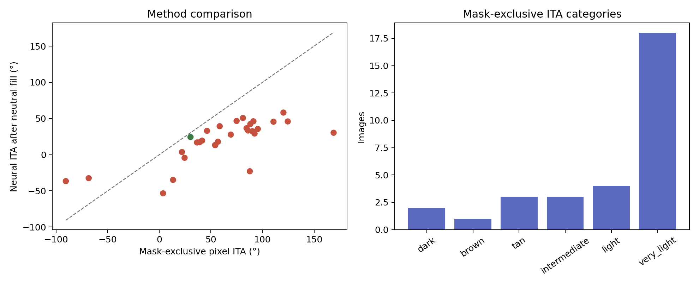

# Results

Reports and per-image outputs from experiments. No source images are included.

| Folder | Experiment |
|---|---|
| [`scin-200-efst-check`](scin-200-efst-check) | The published colorimetry model on 200 SCIN clinical photos: 100 rated Fitzpatrick 1–3 by dermatologists and 100 rated 4–6. Within one type 88.5% of the time, exact match 39.5%, and lighter images systematically pushed darker. [Report](scin-200-efst-check/scin-efst-colorimetry-report.txt) |
| [`scin-30-masked-rerun`](scin-30-masked-rerun) | The same check on 30 SCIN images after removing black (masked) pixels, compared with unmasked inputs |
| [`scin-requested`](scin-requested) | Per-image comparison of expected Fitzpatrick/ITA from SCIN labels against k-means ITA and the colorimetry model, including manually cropped variants |
| [`isic-mask-audit`](isic-mask-audit) | Mask-exclusive pixel ITA against neural ITA on 31 masked ISIC dermoscopy images. The median difference is 45°. [Report](isic-mask-audit/REPORT.md) |
| [`ddi-workimage-audit`](ddi-workimage-audit) | The same comparison on 19 masked DDI (Stanford Diverse Dermatology Images) images. [Report](ddi-workimage-audit/REPORT.md) |
| [`ddi-base-inference`](ddi-base-inference) | Per-fold Fitzpatrick predictions from the released model on DDI |
| [`spreadsheets`](spreadsheets) | Working spreadsheets (Apple Numbers) of expected vs. predicted Fitzpatrick |

